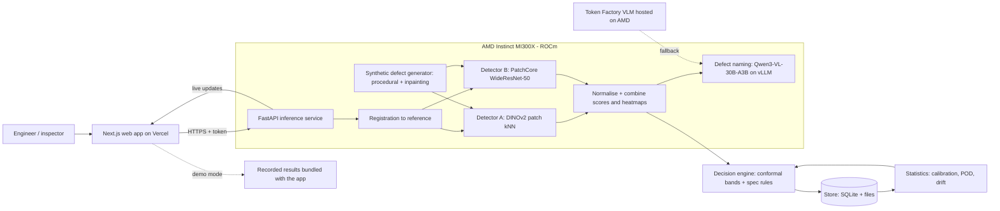

# GoodPart

**Visual defect inspection that learns from good parts only, and tells you in advance how reliable it will be.**

Built for the **AMD Developer Hackathon: ACT III**, track **Intelligent Industry**.

> **Status:** working end to end on an AMD Instinct MI300X (AMD Developer Cloud, ROCm 10.1, PyTorch 2.14). Evaluated on all 12 VisA categories and every official test image. Every number in section 7 is generated from `results/*.csv` by `scripts/readme_tables.py`, never typed by hand. Results not yet measured are marked `—`.

| | |
| --- | --- |
| Live app | [goodpart.vercel.app](https://goodpart.vercel.app) (demo mode: recorded results from the AMD MI300X) |
| Code | [github.com/suyog3006/GoodPart](https://github.com/suyog3006/GoodPart) |
| Demo video | `<link to MP4>` |
| Slides | `<link to PDF>` |
| lablab.ai submission | `<submission link>` |

---

## 1. The problem, in simple words

Factories have to catch damaged parts (a crack, a scratch, a missing piece) before they ship to a customer.

Today, a person usually looks at every part, or a camera checks it with hand-written rules. People get tired and miss things. The camera rules break whenever the product, the colour or the lighting changes.

Modern AI could do much better, but the usual way of training it needs **hundreds of photos of each kind of defect**. A good factory makes very few defective parts, so those photos don't exist.

So defects still reach customers, good parts get thrown away by mistake, and inspectors spend most of their day looking at parts that were fine all along.

---

## 2. Who faces this problem

| Who | Their situation | What hurts |
| --- | --- | --- |
| **Quality engineer** at a small or mid-sized plant | Responsible for what ships; no machine-vision specialist on staff | Cannot set up or trust an automated inspection system for each new product |
| **End-of-line inspector** | Checks hundreds or thousands of parts per shift by eye | Fatigue; most of the time is spent on parts that are obviously fine |
| **Line supervisor** | Runs the shift | Learns about defect problems late, from scrap counts or complaints |
| **Contract manufacturer** | Changes products often | Every changeover means retuning inspection from scratch |
| **The plant's customer** | Receives the parts | Defects that escape cause returns, complaints and lost contracts |

Typical products: moulded plastics, electronics boards, machined parts, packaging, consumer goods.

---

## 3. What needs to be fixed

An inspection system these users can actually adopt has to:

1. **Work without defect photos.** It must learn from good parts only.
2. **Set up fast.** A new product should take minutes and a few dozen photos, not weeks.
3. **Make decisions with known error rates.** Before relying on it, a quality manager needs to know how often it wrongly rejects good parts and how often it misses defects.
4. **Know its limits in advance.** Which defect sizes will it reliably catch?
5. **Judge parts against the customer's specification.** A 0.3 mm mark on a hidden surface may be acceptable; the same mark on the visible face is not.
6. **Keep people in charge of doubtful cases.** Automate the clear decisions and send only the uncertain ones to an inspector.
7. **Explain every rejection.** Show where the defect is, how big it is and what it looks like.
8. **Notice when conditions change.** A moved camera or new lighting silently ruins accuracy; the system must warn before false rejects pile up.
9. **Be pleasant and fast to use.** Operators on a shop floor need an interface that is clear at a glance, works on a tablet, and never makes them hunt for the decision.

---

## 4. Ways it can be fixed

| Approach | Needs defect photos? | Setup effort | Main weakness |
| --- | --- | --- | --- |
| Better manual inspection (checklists, rotation, magnifiers) | No | Low | Still limited by human attention |
| Rule-based machine vision | No, but needs expert tuning | High per product | Brittle to changes; misses unforeseen defects |
| Golden-template comparison | No | Low | Breaks with small position or lighting changes |
| Supervised defect detection | **Yes, many** | High | The data does not exist |
| Unsupervised anomaly detection | No | Medium | Gives a score, not a trustworthy decision |
| Few-shot anomaly detection with foundation features | No (only a few good photos) | Low | Same as above; very new methods |
| Zero-shot vision-language models | No | Very low | Unreliable on small, subtle defects |
| Synthetic defect generation | No (defects are generated) | Medium | Generated defects may not look like real ones |
| Hybrid (anomaly detection, then supervised once defects accumulate) | Later | Medium | Supervised part only helps after months of data |

---

## 5. The approaches, briefly explained

- **Better manual inspection.** Improve the human process: lighting, checklists, job rotation. Cheap, but the ceiling is human attention.
- **Rule-based machine vision.** Engineers program the camera system with measurements and thresholds ("edge must be straight within 0.1 mm"). Precise for the defects someone anticipated; blind to anything else, and every new product needs re-tuning.
- **Golden-template comparison.** Average many good images into a "golden" reference and flag pixels that differ. Simple and explainable, but any shift in position or lighting looks like a defect.
- **Supervised defect detection.** Train a detector or segmentation model on labelled photos of each defect type. Very accurate when the data exists; for most plants it doesn't.
- **Unsupervised anomaly detection.** Learn what normal parts look like and flag anything unusual, with a heatmap of where. Methods such as PatchCore compare small image patches with a memory of normal patches. This needs only good parts, but the output is a score, and someone must still decide where to draw the line.
- **Few-shot anomaly detection with foundation features.** Use features from large self-supervised vision models (the DINOv2 family) so that a handful of good images is enough to describe normal.
- **Zero-shot vision-language models.** Ask a model that understands images and text, "Is this part defective?" No training needed, but these models are unreliable on small, low-contrast defects and give no error rates.
- **Synthetic defect generation.** Paint artificial defects onto good images, either procedurally (noise blobs, strokes, cut-and-paste patches) or with image-generation models. Useful for testing and training, provided you check that real defects behave the same way.
- **Hybrid.** Start with anomaly detection; once inspectors have confirmed enough real defects, add a supervised classifier for the common defect types.

---

## 6. Our solution: GoodPart

### 6.1 The idea in one paragraph

GoodPart builds an inspection station from a few dozen photos of good parts. Before production starts, it stress-tests itself on thousands of synthetic defects and reports which defect sizes it will reliably catch. It then sets its decision thresholds with statistical guarantees on false rejects, and judges each flagged region against the customer's own acceptance specification. Clear passes and clear rejects are automated, doubtful parts go to an inspector, and every decision is explained in a fast, purpose-built web interface designed for the shop floor.

> *Set up an inspection station from about 30 good photos. Before you've seen a single real defect, GoodPart tells you which defect sizes it will catch, bounds your false-reject rate, and judges defects against your own specification.*

### 6.2 What makes it different

| # | Component | What it does | Why it matters |
| --- | --- | --- | --- |
| 1 | **Few-shot anomaly detection** | Two complementary detectors, patch kNN on DINOv2-family features and PatchCore on WideResNet-50, normalised and combined | Stations built from 10–50 images instead of hundreds (section 6.3) |
| 2 | **Risk-controlled decisions** | Conformal calibration of thresholds, giving a guaranteed bound on the false-reject rate; miss rates reported with exact confidence bounds | Gives a quality manager a number to sign off, not just a score |
| 3 | **Synthetic defect stress test** | Thousands of controlled synthetic defects, producing a probability-of-detection (POD) curve against defect size | Tells you the smallest reliably detected defect before production starts |
| 4 | **Spec-aware acceptance** | Zones on the part, each with its own tolerances; defects measured in mm and judged against the spec | Matches how cosmetic and functional inspection specs actually work |
| 5 | **Registration and drift guard** | Aligns every image to the reference; warns when score statistics shift | Removes false alarms from fixture play; catches moved cameras and new lighting |
| 6 | **Shop-floor web interface** | A custom React/Next.js app: decision-first inspection console, keyboard-driven review, live camera, zone editor, interactive calibration | Operators trust and adopt what they can read at a glance (section 6.6) |

The vision-language model only **names** defect types for the report. It never decides pass or reject. We serve **Qwen3-VL-30B-A3B-Instruct** with vLLM on the same MI300X as the detectors; AMD Token Factory is the fallback, and template text is the last resort. (We started with Qwen2.5-VL-7B: it answered 8 concurrent requests in 0.83 s but mislabelled most stains as scratches or chips; the 30B mixture-of-experts model labels them correctly at 2.5 s for 8 concurrent requests, and fits next to the detectors in 192 GB.)

### 6.3 Anomaly detection method

GoodPart scores each image with two complementary detectors, both trained only on good parts. It combines their scores after normalising them on calibration images. Which detector, or which combination, is used per station is decided by validation results, not fixed in advance.

#### Detector A: patch kNN on foundation features (few-shot)

Based on the AnomalyDINO line of work (verify the paper's settings and results before relying on them):

1. **Features.** Resize the registered image (e.g., to 448 or 672 px on the short side) and pass it through a DINOv2-family vision transformer. Keep the **patch tokens**: one feature vector per 14×14-pixel patch.
2. **Foreground mask (optional).** For objects on a plain background, mask background patches so that background texture cannot raise the score. For example, threshold the first principal component of the patch features, or use the zone map.
3. **Memory bank.** Store all foreground patch features from the k good build images (k = 1–50), optionally with light augmentations such as small rotations and flips.
4. **Patch score.** For each test patch, compute the cosine distance to its nearest neighbour in the memory bank (k = 1).
5. **Image score.** Take the mean of the top 1% of patch scores. This is more robust than the single maximum.
6. **Heatmap.** Upsample patch scores to image resolution (bilinear) and smooth them with a Gaussian.

**Why:** self-supervised ViT features describe local structure well enough that a few good images suffice.

#### Detector B: PatchCore on WideResNet-50 (strong with more images)

Following Roth et al., CVPR 2022:

1. **Features.** Mid-level feature maps (layers 2 and 3) of an ImageNet-pretrained WideResNet-50. Layer 3 is upsampled to layer 2's resolution, and the two are concatenated.
2. **Local aggregation.** Average each position's features over its 3×3 neighbourhood. This makes each patch feature aware of its surroundings and tolerant to small misalignments.
3. **Coreset memory bank.** Greedy coreset subsampling keeps about 1–10% of all build patches while still covering the feature space. This shrinks memory and search cost without losing coverage.
4. **Patch score.** The distance from each test patch to its nearest neighbour in the coreset.
5. **Image score.** The maximum patch score, re-weighted by how isolated that nearest neighbour is (PatchCore's re-weighting step).
6. **Heatmap.** Upsampled patch scores with Gaussian smoothing.

**Why:** a well-established method with strong published results on industrial benchmarks, and the natural reference point for judges.

#### Combining and normalising

- Each detector's image score is converted to a robust z-score using the calibration good parts: `z = (score - median) / MAD`.
- The combined score is the maximum of the two z-scores. A defect is flagged if either detector strongly objects. Heatmaps are combined in the same way.
- All thresholds in section 6.5 are set on the **combined** score. If one detector is clearly better for a station, the other is switched off for that station.

#### Other anomaly detection methods considered

| Method | Idea | Why it is not our default |
| --- | --- | --- |
| PaDiM | One Gaussian distribution per patch position | Needs precise alignment; weaker few-shot behaviour |
| EfficientAD | Student–teacher network plus autoencoder | Very fast inference, but needs training per station; a candidate for edge deployment later |
| DRAEM | Reconstruction network plus a discriminator trained on synthetic anomalies | Training per station; relies on synthetic anomalies resembling real ones |
| Normalizing flows (FastFlow, CFlow) | Learn the density of normal features | Training per station; more tuning |
| Golden-template difference | Pixel difference from an average good image | Used as a baseline only |
| Zero-shot vision-language model | Ask a model whether the part is defective | Used as a baseline only |

### 6.4 End-to-end user workflow

1. **Create a station.** Name the product, upload good photos, and photograph the part next to a printed scale marker so the system can measure in mm.
2. **Draw zones.** On the reference image, mark areas such as "A: visible face", "B: hidden face" and "F: functional edge", and enter each zone's tolerances.
3. **Build.** GoodPart extracts features and builds both memory banks on the AMD GPU, showing live progress.
4. **Stress test.** It generates synthetic defects of controlled size and contrast and produces the POD curve, including the smallest defect it detects 90% of the time with 95% confidence.
5. **Calibrate.** Pick a target false-reject rate and a maximum review share using sliders; the thresholds and the guarantee update live.
6. **Inspect.** Each part gets pass, review or reject, with a heatmap, measured defects, the zone each defect sits in, and the reason (e.g., "scratch 2.4 mm in zone A, tolerance 1.0 mm: reject").
7. **Review.** Inspectors resolve doubtful parts with keyboard shortcuts. Confirmed good parts enlarge the calibration set and tighten the guarantee; confirmed defects feed the real-defect statistics.
8. **Monitor.** The shift summary shows rates, review load, defect types and where defects occur on the part. A drift alert appears if conditions change.

### 6.5 Pipelines

#### A. Station build

1. Detect the scale marker and compute mm per pixel.
2. Pick the sharpest, most centred good image as the reference; register all other good images to it (ORB or SIFT keypoints with a RANSAC homography; marker-based alignment as fallback).
3. Run image-quality checks (blur, exposure, duplicates) and report rejected uploads.
4. Split good images into **build** and **calibration** sets.
5. Extract features on the GPU and build both detectors' memory banks (section 6.3).
6. Store the memory banks and record the build time.

#### B. Synthetic defect stress test

1. For each build image, generate defects with **known masks** across a grid of sizes and contrasts:
   - procedural: Perlin-noise blobs, scratch strokes, cut-and-paste patches from other parts of the image (the families used by DRAEM and CutPaste);
   - diffusion inpainting of scratches, cracks and stains inside random masks, with an inpainting model whose licence permits our use.
2. Score every synthetic image with the station's combined detector.
3. Record each defect as hit (scored above the lower threshold) or miss, together with its size `a` (equivalent diameter in mm) and contrast.
4. Fit a hit/miss probability-of-detection model, per contrast bin:
   `logit(POD(a)) = b0 + b1 * log(a)`.
5. Report `a90` (the size detected 90% of the time) and `a90/95` (the one-sided 95% upper confidence bound on that size, so we are 95% confident that POD ≥ 90% from `a90/95` upward), following the convention of MIL-HDBK-1823A for non-destructive evaluation.
6. **Validation:** check the synthetic POD curve against real defects (VisA defect masks give real sizes). The report says plainly whether the synthetic curve predicts real-defect detection.

#### C. Calibration with guarantees

- **Upper threshold `t_high` (reject).** Score the `n` calibration images of good parts. With target false-reject rate `alpha`, set `t_high` to the `ceil((n + 1) * (1 - alpha))`-th smallest calibration score. If parts are exchangeable with the calibration set, the probability that a good part is rejected is at most `alpha`.
  - The guarantee needs enough images: `n >= 1/alpha - 1`. That means 19 good images for 5%, or 99 for 1%.
  - Stations therefore start with a looser guarantee, and it tightens automatically as inspectors confirm good parts.
  - The review band needs enough calibration parts too: with fewer than about 30, Learn-then-Test can certify only a very narrow band, so a new station built from 30 photos mostly passes or rejects. We recommend 60 or more good photos at setup.
- **Lower threshold `t_low` (pass).** Chosen with Learn-then-Test so that, with high probability, the share of good parts landing in review stays below a cap (e.g., 15%). Among the admissible values, pick the one that minimises misses on synthetic defects.
- **Miss rate.** Wherever real defects are available, report misses `k` out of `m` with an exact Clopper–Pearson 95% upper bound. Synthetic miss rates are shown separately and never mixed with real ones.
- The guarantee is marginal and holds only while conditions match the calibration data. The drift guard (pipeline F) exists because of this assumption.

#### D. Inspection (per image)

1. Register the image to the reference; reject the image as unusable if registration fails (too blurry, wrong part, part missing).
2. Score with both detectors and normalise into the combined score and heatmap (section 6.3).
3. Statistical band: `score < t_low` gives **pass**; `score >= t_high` gives **reject**; anything in between gives **review**.
4. Turn the heatmap into regions: threshold it at a level calibrated on good parts, keep connected components, and compute each region's area, length and elongation in mm.
5. Map each region into zones and apply the zone rules. A region outside its zone's tolerance makes the part **reject**. An anomalous region inside tolerance is noted in the report but does not force a rejection by itself.
6. Name each flagged region: the crop and heatmap overlay go to the vision-language model, which must answer with one label from a fixed list (scratch, crack, chip, stain, contamination, missing feature, deformation, other) plus a one-sentence description, as JSON.
7. Combine everything into the final decision with a human-readable reason; store it with device and latency, and push it to the interface in real time.

#### E. Review feedback loop

- Parts confirmed good are added to the calibration set, which periodically re-runs pipeline C.
- Confirmed defects update the real miss-rate statistics.
- Reviewer corrections to defect names are logged as future training data for a supervised head (roadmap).

#### F. Drift guard

- Track the score distribution of passed parts in rolling windows.
- Compare each window with the calibration distribution using a two-sample test (Kolmogorov–Smirnov on scores; optionally maximum mean discrepancy on embeddings).
- When the test fires, raise a drift alert, pause the guarantee shown in the app, and propose re-registration or recalibration.

#### G. Logical anomalies (stretch goal)

Count, position and orientation checks per component (e.g., segment components, then apply rules), for defects such as a missing or swapped component where every individual patch still looks normal.

### 6.6 User interface

The interface is a custom web app built with **Next.js (React, TypeScript)** and deployed on **Vercel**, one of the three demo platforms allowed by the lablab.ai rule book. It is designed for three contexts: an engineer at a desk setting up a station, an inspector at a tablet on the line, and a judge opening a URL.

#### Design principles

- **Decision first.** The pass, review or reject state is the largest element on screen, shown with colour, icon *and* text, so it stays readable for colour-blind users and in bright factory light.
- **Evidence one click away.** Every decision shows its heatmap, measured regions, zone and reason; every number in a report links to the images behind it.
- **Keyboard and touch.** Large touch targets for tablets; keyboard shortcuts for fast review (`G` good, `D` defect, `1`–`8` defect type, arrows to move, `Z` undo).
- **Fast and live.** Optimistic UI updates; build, stress-test and inspection progress stream in real time over WebSocket or server-sent events.
- **Honest about compute.** Every result shows a badge with the device that produced it (`AMD MI300X` or `CPU`) and its latency.
- **Works when the backend doesn't.** A clearly labelled **demo mode** ships recorded results for two stations with the app, so the URL always works. Live mode connects to the GPU service.
- **Light and dark themes**; dark by default on line displays.

#### Screens

| Screen | What it shows | Key interactions |
| --- | --- | --- |
| **Stations** | Cards per station: status, guarantee level, a90/95, today's counts, drift status | Create, open, duplicate a station |
| **Setup wizard** | Drag-and-drop upload with quality checks (blur, exposure, duplicates); scale-marker detection; reference selection | Fix or drop flagged photos; confirm the scale |
| **Zone editor** | Reference image with drawable polygons; a tolerance form per zone | Draw, edit and name zones; set max length, area, count |
| **Build and stress test** | Live progress with GPU timings; POD curve with confidence band; a90/95 callout; gallery of synthetic hits and misses by size; synthetic-versus-real agreement plot | Filter the gallery by size and contrast; re-run with more samples |
| **Calibration** | Histogram of good-part scores and synthetic-defect scores with the two thresholds; the guarantee in plain words ("with 120 calibration parts, false rejects ≤ 1%") | Drag sliders for target false-reject rate and review cap; see thresholds and expected review share update live |
| **Inspection console** | Large decision banner; image with heatmap overlay (opacity slider) and outlined regions labelled with mm and zone; reason text; device and latency badge | Single image, batch grid with filters, or **live camera** in the browser |
| **Review queue** | Doubtful parts side by side with the reference and heatmap; progress counter | Keyboard-first labelling; undo; bulk actions |
| **Shift summary** | Rates over time, review load, defect types, a map of where on the part defects occur, drift indicator | Change the time window; export a PDF or CSV report |
| **Evaluation and benchmarks** | Results tables and charts from `results/*.csv`; baseline comparison; GPU vs CPU benchmark charts; cost per 1,000 inspections | Switch category and backbone |
| **Failure gallery** | Missed defects and false rejects from evaluation | Inspect each case with its heatmap |

#### Frontend stack

- **Framework:** Next.js (App Router) with TypeScript.
- **Styling and components:** Tailwind CSS and shadcn/ui (Radix-based, accessible components).
- **Image work:** react-konva for the zone editor, region outlines and heatmap overlays on canvas.
- **Charts:** Recharts or visx for POD curves, histograms and benchmarks.
- **Data:** TanStack Query; types generated from the FastAPI OpenAPI schema (openapi-typescript); Zod for validation.
- **Live:** WebSocket or server-sent events for progress and inspections; the browser camera API for live capture.
- **Testing:** Mock Service Worker, so frontend work proceeds before the backend is ready.

#### Connecting Vercel to the GPU service

- The Vercel app runs over HTTPS, so the inference API must also be served over HTTPS, to avoid browsers blocking mixed content. Use a reverse proxy with automatic certificates (e.g., Caddy) or a tunnel service on the GPU machine.
- The API accepts requests only from the app's domain (CORS) and with a bearer token held server-side in Next.js route handlers, never shipped to the browser.

### 6.7 System design



| Service | Responsibility | Runs on |
| --- | --- | --- |
| **Web app (Next.js)** | All screens in section 6.6; server-side route handlers that hold the API token; demo mode | Vercel |
| **Inference service (FastAPI)** | Registration, both detectors, synthetic generation, live updates, timing logs | AMD GPU via PyTorch on ROCm |
| **vLLM server** | Qwen3-VL-30B-A3B-Instruct for defect naming and the zero-shot baseline, JSON output | AMD GPU via vLLM on ROCm |
| **Decision engine** | Bands, geometry, spec rules, final decision and reason | CPU, deterministic |
| **Statistics module** | Conformal thresholds, Learn-then-Test selection, Clopper–Pearson bounds, POD fitting, drift tests | CPU |
| **Store** | SQLite metadata plus image, heatmap and memory-bank files | GPU machine disk |

**Data model**

| Entity | Key fields |
| --- | --- |
| `Station` | product name, active detectors, image size, mm-per-pixel scale, created at |
| `ReferenceImage` | station, path, role (build / calibration), quality flags, registration keypoints |
| `ZoneMap` | station, polygons, per-zone rules (max length mm, max area mm², max count) |
| `MemoryBank` | station, detector, backbone, size, file path |
| `Calibration` | station, alpha, review cap, t_low, t_high, normalisation stats, n calibration images, guarantee achieved |
| `StressTest` | station, synthetic defect set, POD fit parameters, a90, a90/95 |
| `Inspection` | station, image, combined score, per-detector scores, decision, reason, device, latency |
| `DefectRegion` | inspection, bounding box, area mm², length mm, zone, defect name |
| `ReviewLabel` | inspection, reviewer, label (good / defect), defect type, time |
| `DriftEvent` | station, window, test statistic, p-value, action taken |

### 6.8 Where AMD makes a difference

| Workload | Why the GPU matters | Measured on MI300X | Same code on CPU (20 threads) |
| --- | --- | --- | --- |
| Station build, 100 good images (both detectors) | Dense ViT and CNN inference at high resolution, coreset selection | 8.1 s | 604 s |
| Full station build, ~600 images (bank of 1.4 M DINOv2 patches + 96 k PatchCore coreset) | Greedy coreset over ~1 M patch features | about 71 s (`build_A_s` + `build_B_s` in `results.csv`) | not measured |
| Stress-test scoring | Hundreds of synthetic images through two detectors | 65.6 images/s | 0.22 images/s |
| Inspection, batch size 32 | Batch use | 75.6 images/s | 0.19 images/s |
| Inspection, single part, p95 latency | Interactive use | 22 ms | 17.2 s |
| Defect naming (Qwen3-VL-30B-A3B on vLLM, same GPU) | 30B vision-language model next to the detectors | 8 concurrent requests in 2.5 s | n/a |
| Memory | 192 GB: both detectors, full memory banks and a 30B VLM resident together | VLM capped at 45% of GPU memory | n/a |
| Cost per 1,000 inspections | At $1.99 per GPU-hour (AMD Developer Cloud, 1× MI300X) | $0.0073 | n/a |
| Whole evaluation: 24 stations, 2,162 test images, 12,960 synthetic defects | | 27 minutes | not practical |

Every result records the device that produced it and its latency. `scripts/benchmark.py` reproduces all timings.

### 6.9 Tech stack

- **Backend:** Python 3.12; PyTorch (ROCm build); DINOv2-family backbone (Hugging Face Transformers or torch hub); WideResNet-50 (torchvision); anomalib optional; torch nearest-neighbour search (faiss-cpu as an alternative); OpenCV; NumPy, SciPy, statsmodels; diffusers; vLLM; FastAPI; SQLite. Run inside AMD's ROCm PyTorch and vLLM containers.
- **Frontend:** Next.js and TypeScript, Tailwind CSS, shadcn/ui, react-konva, Recharts or visx, TanStack Query, Zod; deployed on Vercel.
- **No paid APIs.** The vision-language model has three modes: self-hosted vLLM, hosted AMD Token Factory, or template text.

---

## 7. Evaluation

### Data

- **[VisA](https://registry.opendata.aws/visa):** 10,821 images (9,621 normal, 1,200 anomalous) of 12 object types, with pixel-level masks. Licensed CC BY 4.0 per the AWS Open Data registry. Downloaded by script, never committed. We use 4–6 categories.
- **Our own physical set:** about 150 good and 30 deliberately damaged parts, photographed on a phone stand under a fixed lamp with a printed scale marker. Labelled by the team and released with this repository.

### Baselines

1. **Golden-template difference.** Compare each image with the average good image.
2. **Zero-shot vision-language model.** Ask Qwen3-VL-30B-A3B (served on our MI300X) whether the part is defective and where.
3. **PatchCore with WideResNet-50 and a default single threshold.**

### Metrics

| Metric | What it shows |
| --- | --- |
| Image-level AUROC (per detector and combined) | How well scores separate good from defective |
| Localisation (AUPRO) | Whether heatmaps point at the real defect |
| Miss rate and false-reject rate at the operating point, with Clopper–Pearson bounds | The errors a quality manager cares about |
| Review share | Inspector workload |
| Guarantee validity | Realised false-reject rate on test data versus the conformal bound |
| POD agreement | Synthetic POD curve versus detection of real VisA defects by size |
| Few-shot curve | AUROC with 1, 8, 16, 32 and all build images, for each detector and the combination |
| Spec decision accuracy | On the own set, agreement of zone-rule decisions with the team's labels |
| Review speed | Seconds per reviewed part in the review queue, measured during the team's own labelling |
| Setup time, throughput, latency, cost per 1,000 inspections | Operational value of the AMD GPU |

### Protocol

- Build, calibration and test splits never overlap; thresholds are never tuned on test data.
- Fixed seeds and one config file per experiment; results written to `results/*.csv` with bootstrap confidence intervals.
- A failure gallery in the app shows missed defects and false rejects openly.

### Results

Generated by `scripts/readme_tables.py` from `results/visa_full/*.csv` (AMD Instinct MI300X, 14 Oct 2026). 1,200 defective and 962 good test images over 12 categories. Miss rate = defects passed without review. Bounds are exact one-sided 95% Clopper–Pearson. ⚠ marks a false-reject rate above the 1% guarantee by more than chance (binomial test, p < 0.05). a90/95 is in pixels at 768 × 768, because VisA has no scale marker.

**Full station (every remaining good image)**

| Category | Good images | Detectors | AUROC (A / B / station) | AUPRO | Miss rate (95% upper) | False-reject rate (95% upper) | Review share | a90/95 (px at 768) |
| --- | --- | --- | --- | --- | --- | --- | --- | --- |
| candle | 600 | A+B | 0.957 / 0.981 / **0.967** | 0.973 | 5.0% (10.2%) | 1.0% (4.7%) | 18% | 22 |
| capsules | 242 | A | 0.975 / 0.694 / **0.975** | 0.974 | 10.0% (16.4%) | 0.0% (4.9%) | 28% | 44 |
| cashew | 150 | A+B | 0.970 / 0.980 / **0.982** | 0.974 | 6.0% (11.5%) | 0.0% (5.8%) | 31% | 58 |
| chewinggum | 153 | A+B | 0.987 / 0.985 / **0.989** | 0.937 | 4.0% (8.9%) | 0.0% (5.8%) | 4% | 39 |
| fryum | 150 | A+B | 0.946 / 0.928 / **0.959** | 0.908 | 12.0% (18.7%) | 0.0% (5.8%) | 21% | 38 |
| macaroni1 | 600 | A+B | 0.882 / 0.912 / **0.924** | 0.946 | 22.0% (29.9%) | 1.0% (4.7%) | 30% | 29 |
| macaroni2 | 600 | A+B | 0.862 / 0.607 / **0.825** | 0.975 | 40.0% (48.7%) | 1.0% (4.7%) | 24% | 32 |
| pcb1 | 604 | A+B | 0.970 / 0.970 / **0.977** | 0.964 | 1.0% (4.7%) | 5.0% ⚠ (10.2%) | 12% | 77 |
| pcb2 | 601 | A+B | 0.945 / 0.941 / **0.952** | 0.925 | 5.0% (10.2%) | 5.0% ⚠ (10.2%) | 24% | 63 |
| pcb3 | 605 | A+B | 0.974 / 0.966 / **0.982** | 0.915 | 3.0% (7.6%) | 0.0% (2.9%) | 25% | 38 |
| pcb4 | 604 | A+B | 0.986 / 0.995 / **0.995** | 0.910 | 1.0% (4.7%) | 2.0% (6.1%) | 10% | 52 |
| pipe_fryum | 150 | A+B | 0.982 / 0.992 / **0.995** | 0.977 | 1.0% (4.7%) | 0.0% (5.8%) | 9% | 27 |
| **All 12** | | | 0.953 / 0.912 / **0.960** | 0.948 | 110/1200 = 9.2% (10.7%) | 15/962 = 1.6% (2.4%) | 20% | |

**Few-shot station (32 good images)**

| Category | Good images | Detectors | AUROC (A / B / station) | AUPRO | Miss rate (95% upper) | False-reject rate (95% upper) | Review share | a90/95 (px at 768) |
| --- | --- | --- | --- | --- | --- | --- | --- | --- |
| candle | 32 | A+B | 0.957 / 0.945 / **0.956** | 0.974 | 17.0% (24.4%) | 0.0% (3.0%) | 18% | 31 |
| capsules | 32 | A | 0.975 / 0.652 / **0.975** | 0.966 | 9.0% (15.2%) | 0.0% (4.9%) | 41% | 46 |
| cashew | 32 | A+B | 0.966 / 0.973 / **0.984** | 0.973 | 9.0% (15.2%) | 0.0% (5.8%) | 21% | 60 |
| chewinggum | 32 | A+B | 0.988 / 0.988 / **0.994** | 0.950 | 3.0% (7.6%) | 0.0% (5.8%) | 9% | 39 |
| fryum | 32 | A+B | 0.910 / 0.914 / **0.918** | 0.899 | 21.0% (28.8%) | 0.0% (5.8%) | 27% | 44 |
| macaroni1 | 32 | A+B | 0.818 / 0.853 / **0.848** | 0.930 | 36.0% (44.6%) | 5.0% ⚠ (10.2%) | 26% | 35 |
| macaroni2 | 32 | A+B | 0.810 / 0.582 / **0.781** | 0.946 | 56.0% (64.4%) | 1.0% (4.7%) | 28% | 37 |
| pcb1 | 32 | A | 0.982 / 0.912 / **0.982** | 0.943 | 0.0% (3.0%) | 2.0% (6.2%) | 22% | 120 |
| pcb2 | 32 | A+B | 0.895 / 0.905 / **0.903** | 0.923 | 17.0% (24.4%) | 1.0% (4.7%) | 44% | 78 |
| pcb3 | 32 | A+B | 0.925 / 0.900 / **0.942** | 0.897 | 7.0% (12.7%) | 0.0% (2.9%) | 37% | 50 |
| pcb4 | 32 | A+B | 0.945 / 0.993 / **0.985** | 0.892 | 1.0% (4.7%) | 4.0% ⚠ (8.8%) | 12% | 67 |
| pipe_fryum | 32 | A+B | 0.954 / 0.981 / **0.980** | 0.976 | 3.0% (7.6%) | 0.0% (5.8%) | 33% | 29 |
| **All 12** | | | 0.927 / 0.883 / **0.937** | 0.939 | 179/1200 = 14.9% (16.7%) | 13/962 = 1.4% (2.1%) | 26% | |

**Against the baselines (means over the 12 categories, full stations, same 1% false-reject target)**

| Method | AUROC | Miss rate | False-reject rate | Review share |
| --- | --- | --- | --- | --- |
| Golden-template difference | 0.732 | 91.3% | 1.3% | n/a |
| PatchCore, default threshold | 0.912 | 40.8% | 1.6% | n/a |
| Zero-shot VLM (Qwen3-VL-30B-A3B, its own yes/no answer) | 0.690 | 53.6% | 8.8% | n/a |
| GoodPart, single threshold | 0.960 | 36.2% | 1.2% | n/a |
| **GoodPart (pass / review / reject)** | 0.960 | **9.2%** | 1.2% | 20% |

**Few-shot curve (mean image AUROC over categories)**

| Good images | 1 | 8 | 16 | 32 | 64 | 128 | all |
| --- | --- | --- | --- | --- | --- | --- | --- |
| Detector A (DINOv2 kNN) | 0.840 | 0.904 | 0.919 | 0.927 | 0.934 | 0.944 | 0.953 |
| Detector B (PatchCore) | 0.780 | 0.861 | 0.880 | 0.883 | 0.894 | 0.903 | 0.912 |
| Combined | 0.851 | 0.895 | 0.924 | 0.933 | 0.941 | 0.949 | 0.959 |

**Compute (category pcb1, both detectors, $1.99/GPU-hour)**

| Device | Build (s) | Inspection, batch 32 (img/s) | Single part p95 (ms) | Stress-test scoring (img/s) | Cost per 1,000 inspections |
| --- | --- | --- | --- | --- | --- |
| AMD Instinct MI300X VF | 8.1 | 75.6 | 22 | 65.6 | $0.0073 |
| CPU (20 threads) | 603.7 | 0.2 | 17199 | 0.2 | n/a |


**Reading the results**

- **The review band is what makes the guarantee useful.** At the same ~1% false-reject target, a single threshold passes 36% of defects unseen (PatchCore: 41%). Adding a certified review band cuts that to 9.2%, at the cost of sending about 20% of parts to an inspector.
- **A vision-language model is not an inspector.** Asked directly, Qwen3-VL-30B gets an AUROC of 0.69, misses 54% of defects and rejects 8.8% of good parts. This is why GoodPart uses it only to name defects.
- **Few-shot works.** With 32 good photos the combined station reaches 0.933 mean AUROC (16 photos: 0.924); every photo after that adds little. Detector A (DINOv2) carries the few-shot regime; the combination is best at every size except 8 photos.
- **The guarantee held on 20 of 24 stations,** and failed under measured train/test shift on 4 (see Limitations). Pooled over all full stations: 1.6% realised versus 1% guaranteed.
- **Synthetic POD versus real defects:** on candle the synthetic curve is pessimistic for small defects (it predicts 38% caught at 4–10 px; 90% of real defects that size were caught). Per-category agreement tables are in the app's stress-test screen and in `results/visa_full/*/summary.json`.

---

## 8. Final plan, end to end

### Milestones (in priority order)

| # | Milestone | Exit criterion |
| --- | --- | --- |
| M0 | Compute and compatibility spike | On an AMD GPU: PyTorch on ROCm works; DINOv2 and WideResNet features extract; one VisA category scores end to end; Qwen2.5-VL answers 8 concurrent image requests correctly under vLLM; first timings logged |
| M1 | Anomaly detection and evaluation harness | Both detectors plus the combination evaluated on 4–6 VisA categories, with all three baselines; few-shot curve |
| M2 | Calibration with guarantees | Conformal bands and Learn-then-Test selection implemented; guarantee validity checked on test data |
| M3 | Synthetic stress test and POD | Procedural defects (required) and diffusion inpainting (if the licence and time allow); POD fit, a90/95; synthetic-versus-real agreement measured |
| M4 | Spec-aware acceptance and registration | Scale marker, registration, geometry, zone rules, final decision and reason |
| M5 | Web interface | Stations, setup wizard, zone editor, calibration, inspection console, review queue and evaluation pages working against the live API and in demo mode |
| M6 | Own physical dataset | About 150 good and 30 damaged parts captured, labelled through the review queue, evaluated; live rehearsal |
| M7 | Defect naming and benchmarks | Vision-language naming with template fallback, 50 crops rated by two people; AMD benchmark charts complete |
| M8 | Submission package | Repo, live Vercel URL, MP4 video, PDF slides, 16:9 cover, descriptions; submitted by 17 Oct |
| M9 (optional) | Drift guard, shift-summary map, logical anomalies | Only if M0–M8 are done |

### Schedule

| Day | Backend and models | Frontend |
| --- | --- | --- |
| 13 Oct | Confirm GPU access on every member's account; M0 spike; photo pilot (20 good, 5 damaged) on a laptop CPU | Next.js skeleton, design system, API types, mock data; stations and inspection console against mocks |
| 14 Oct | M1 and M2; procedural defect generator; registration | Setup wizard, zone editor, calibration screen with live sliders |
| 15 Oct | M3 (POD) and M4 (spec rules); capture the own dataset | Build and stress-test screens with live progress; review queue with keyboard shortcuts |
| 16 Oct | Full evaluation run; M7 naming and benchmarks; HTTPS and CORS setup | Connect all screens to the live API; demo mode; evaluation and benchmark pages; polish |
| 17 Oct | Freeze features; README results | Final polish; deploy to Vercel; record video; slides and cover; submit |

### Work split

| Person | Owns |
| --- | --- |
| Computer vision and statistics | Both detectors, normalisation, calibration maths, POD fitting, evaluation harness |
| Backend and serving | ROCm environment, FastAPI service, vLLM, synthetic generation on GPU, live updates, HTTPS, benchmarks |
| Frontend and product | Next.js app, design system, all screens, demo mode, photo rig, demo video, slides, cover |

With two people, the first two roles merge, and the frontend owner also takes the demo assets.

### Top risks and contingencies

| Risk | Early test | Contingency |
| --- | --- | --- |
| No AMD GPU access in time | Check every member's credit and AMD AI Notebooks login today | Use the first account that activates. If none exists by the end of 14 Oct, escalate to the organisers, run the models on CPU and use the Token Factory model as the AMD component; this is weaker but compliant |
| ROCm incompatibility (backbone, inpainting model, vLLM vision attention) | M0 spike, including a concurrency test | Minimal PyTorch implementations; procedural defects only; Token Factory or template naming |
| Synthetic POD does not predict real detection | Synthetic-versus-real agreement on VisA in M3 | Present POD as a stress test, not a guarantee, and report the gap honestly |
| UI scope grows faster than time | Screens prioritised in M5 order; demo mode built early | Cut the shift summary and failure gallery before cutting the inspection console, review queue or calibration screen |
| Vercel cannot reach the GPU API (HTTPS, CORS) | Deploy a test page to Vercel on day 2 that calls the API | Demo mode keeps the URL working; record the live GPU flow in the video |
| Own photos noisier than the benchmark | Photo pilot today | Fixed rig, registration, cropping; fall back to VisA for the live demo |

### Submission checklist

- [ ] Public GitHub repository under the MIT licence, with no keys committed
- [ ] Live application URL on Vercel, with labelled live and demo modes
- [ ] Demo video (MP4) showing AMD GPU operation
- [ ] Slides (PDF)
- [ ] Cover image (PNG or JPG, 16:9)
- [ ] Title, short and long descriptions within the form's limits; track: Intelligent Industry; technology tags
- [ ] README results filled in from `results/*.csv`

---

## 9. Run it

### Backend (on the AMD GPU machine)

Tested on an AMD Developer Cloud GPU Droplet (1× MI300X, ROCm 10.1). Code is edited locally and copied to the droplet; nothing heavy runs on the laptop.

```bash
# From your laptop: copy the code (never data or secrets) to the droplet
GOODPART_HOST=root@<droplet-ip> scripts/sync.sh

# On the droplet: AMD's ROCm PyTorch container, with code, data and model caches mounted
docker run -d --name gp --device=/dev/kfd --device=/dev/dri --group-add video --ipc=host   --shm-size 64g -v /root/goodpart:/workspace/goodpart -v /root/data:/data -v /root/.cache:/root/.cache   -p 8000:8000 -w /workspace/goodpart rocm/pytorch:latest sleep infinity
docker exec gp pip install -r requirements.txt
# /root/goodpart/.env (chmod 600): GOODPART_DATA=/data, GOODPART_STORE=/data/store, VLM_MODE=vllm,
#   VLLM_BASE=http://vllm:8000/v1, GOODPART_API_TOKEN=<random>, AMD_API_KEY=<Token Factory key, optional>

# Vision-language model on the same GPU (45% of its memory), reachable from gp as http://vllm:8000
docker network create gpnet && docker network connect gpnet gp
docker run -d --name vllm --network gpnet --device=/dev/kfd --device=/dev/dri --group-add video   --ipc=host --shm-size 16g -v /root/.cache/huggingface:/root/.cache/huggingface rocm/vllm:latest   vllm serve Qwen/Qwen3-VL-30B-A3B-Instruct --max-model-len 16384 --gpu-memory-utilization 0.45   --limit-mm-per-prompt '{"image": 2}'

# Data, evaluation, few-shot curve, baselines, benchmarks (inside gp)
python -m goodpart.data.visa                                   # download + cache all 12 categories
python -m goodpart.eval.run --config configs/eval_visa.yaml   # stations, calibration, POD, baselines
python -m goodpart.eval.fewshot                                # AUROC vs number of good images
python -m goodpart.eval.zeroshot --mode vllm                   # zero-shot VLM baseline
python scripts/benchmark.py --category pcb1 --compare-cpu      # GPU vs CPU timings
python scripts/vlm_check.py                                    # M0: 8 concurrent naming requests
python scripts/readme_tables.py > results/README_tables.md     # tables for section 7
python scripts/export_demo.py                                  # recorded results for demo mode

# Inference service (bearer token required on every route except /health)
uvicorn goodpart.api.main:app --host 0.0.0.0 --port 8000
python scripts/api_smoke.py                                    # end-to-end: build a station, inspect parts
```

PyTorch on ROCm exposes AMD GPUs through the `cuda` device name, so `DEVICE=cuda` is correct on AMD hardware.

### Saved stations

A station is built once and saved on the GPU machine: its good photos, its trained memory banks, its calibration and its inspection history (`/data/store`: SQLite database, images, one `<station>.pkl` per station). It survives API restarts and reboots, and setup can be resumed at any time from the Stations page; nothing is uploaded twice. Photos upload a few at a time, so any number works through the hosted app.

To keep stations when the droplet is destroyed, copy them to your computer first and put them back on the new droplet:

```bash
scripts/store_backup.sh                 # your stations -> ~/goodpart_data/store_backup (WITH_SHOWCASE=1 adds the 2 VisA stations, ~5 GB)
scripts/store_restore.sh root@<new-ip>  # back onto a new droplet
scripts/restart_api.sh root@<new-ip>    # restart the API so it loads them
```

### Frontend

```bash
cd web
npm install
cp .env.example .env.local      # GOODPART_API_URL, GOODPART_API_TOKEN (server-side only), NEXT_PUBLIC_DEMO_MODE
# For local development against the droplet, tunnel the API instead of exposing it:
#   ssh -N -L 8000:localhost:8000 root@<droplet-ip>   and set GOODPART_API_URL=http://localhost:8000
npm run dev                     # local development
npx vercel --prod               # deploy
```

**Never commit `.env`, `.env.local` or any key.**

### Repository layout

```
goodpart/
├── goodpart/               # Python backend
│   ├── api/                # FastAPI service, live updates
│   ├── models/             # Detector A (DINOv2 kNN), Detector B (PatchCore), baselines
│   ├── register/           # markers, alignment, quality checks
│   ├── stress/             # synthetic defects, POD fitting
│   ├── calibrate/          # normalisation, conformal bands, Learn-then-Test, bounds
│   ├── spec/               # zones, geometry, rules
│   ├── describe/           # vision-language naming + template fallback
│   ├── drift/              # drift tests
│   ├── data/               # downloads, splits
│   └── eval/               # metrics, experiment runner
├── web/                    # Next.js frontend (Vercel)
│   ├── app/                # routes: stations, setup, zones, calibrate, inspect, review, summary, eval
│   ├── components/         # decision banner, heatmap viewer, zone editor, charts
│   ├── lib/                # API client (generated types), demo-mode data
│   └── public/demo/        # recorded results for demo mode
├── configs/  scripts/  results/  data/ (git-ignored)
├── .env.example  requirements.txt  LICENSE  README.md
```

---

## 10. Limitations

- The false-reject guarantee holds only while production conditions match the calibration data, and it is a marginal (on-average) guarantee. Drift breaks it, which is why the drift guard exists.
- Synthetic defects may not match real ones. The POD curve is validated against real benchmark defects, but not against any real production line.
- Small calibration sets give loose guarantees; they tighten as reviewed good parts accumulate.
- Camera, fixture and lighting must stay fixed. GoodPart is not suitable for certifying safety-critical parts.
- Demo mode shows recorded results; it is labelled as such and is not evidence of live operation.
- **Measured on VisA:** the 1% false-reject guarantee held on 20 of 24 stations, but was exceeded beyond chance on 4 (pcb1 and pcb2 full stations, macaroni1 and pcb4 few-shot), each at 4–5% on 100 test good parts. On these categories the VisA test split's good parts score differently from the training split's (two-sample KS p = 0.003 for pcb1), which breaks the exchangeability the guarantee rests on. Pooled over all categories the realised false-reject rate was 1.6% (95% upper bound 2.4%) for full stations. Our drift test, at its alert level of p < 0.001, would not have caught these subtler shifts.
- Station selection uses synthetic defects only. It correctly switches off PatchCore on capsules (AUROC 0.69 vs 0.98), but keeps it on macaroni2, where it hurts (0.61 vs 0.86).
- VisA images are resized to 768 × 768, which changes their aspect ratio; defect sizes on VisA are therefore reported in pixels, not millimetres. Millimetre measurement needs the printed scale marker in our own photos.
- Defect names come from a 30B vision-language model and are not perfect: it reliably names stains and scratches but called bent PCB leads "scratch" or "contamination" in our check.

## Team

| Name | Role |
| --- | --- |
| `<name>` | Computer vision and statistics |
| `<name>` | Backend and serving |
| `<name>` | Frontend and product |

## Acknowledgements and third-party licences

- **AMD**, for AMD Developer Cloud, ROCm and the hackathon; **lablab.ai**, for organising it.
- **PatchCore:** Roth et al., *Towards Total Recall in Industrial Anomaly Detection*, CVPR 2022.
- **DINOv2:** Oquab et al., 2023. **AnomalyDINO:** Damm et al. Verify licences and results on the original pages.
- **DRAEM:** Zavrtanik et al., ICCV 2021. **CutPaste:** Li et al., CVPR 2021. **PaDiM**, **EfficientAD**, **FastFlow** and **CFlow** are referenced as alternatives.
- **Conformal prediction / Learn-then-Test:** Angelopoulos, Bates et al. **POD methodology:** MIL-HDBK-1823A.
- **VisA:** Zou et al., ECCV 2022; CC BY 4.0 per the AWS Open Data registry.
- **Qwen2.5-VL-7B-Instruct** (Apache-2.0; confirm on the model card), **vLLM**, **PyTorch**, **OpenCV**, **diffusers**, **Next.js**, **shadcn/ui**, **react-konva**.
- **Inpainting models:** check each model's licence before use; some popular ones are non-commercial.

## Licence

[MIT](LICENSE) for the code in this repository. Datasets and model weights are not included and remain under their own licences.
